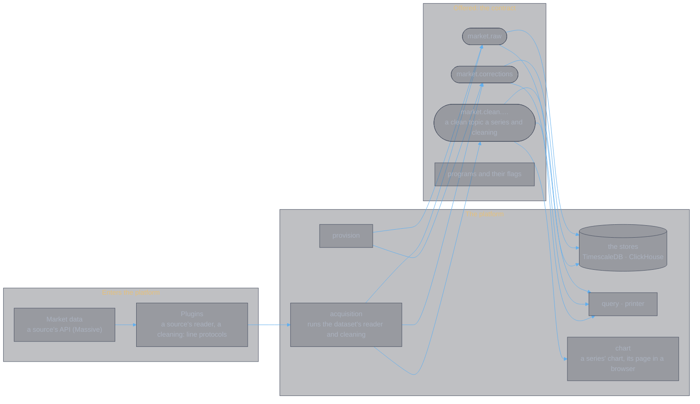

# qi-v2-platform

**The streaming architecture and the operations that run on the stream.**

Market data are events on Redpanda (Kafka-compatible) topics, partitioned by instrument and kept forever; this repository is everything that moves them onto, along and off that stream: the core, its topics and their schemas, and the additions on it, each a publisher or a consumer.

**The core** ([`core/README.md`](core/README.md)), a Go module of its own: the stream, the provisioning of
the raw market data topic `market.raw` and the market corrections topic `market.corrections`, and their schemas, the
raw market data 0.3.0 and the market corrections 0.1.0, which name no source, on which every function is an addition, a
publisher or a consumer. Its first path: Massive's reader, a source plugin (`plugins/massive-reader`), a thin program
over the platform's library, read by acquisition (`publishers/acquisition`), which publishes every minute of SPY's
session on `market.raw`, each first version, and each minute Massive revises after on `market.corrections`; a consumer,
the printer (`consumers/printer`), reads `market.raw`; another, `query` (`consumers/query`), answers the common
questions of both topics (their topics and series, a series' bars, a minute's every version, the corrections, where
each consumer group stands), read only, in no group; the charting consumer, `chart` (`consumers/chart`), draws one
series' clean topic in a browser by visualization's `@qi/chart`, updated as its K-lines come; `dataset`
(`consumers/dataset`) makes a K-line data set of a clean topic's sessions, published as an image on GHCR and pinned by its
lock in `datasets/` ([`datasets/README.md`](datasets/README.md)). The stores on it are consumers too, each a module under
`consumers/` keeping the two topics' K-lines in a database of its own, four series (its README). `make start` runs
them, acquisition and both stores, while the stack is up.

**The platform's library** ([`lib/README.md`](lib/README.md)), a Go module of its own on market's Go form and the
standard library alone: what reads a source, as packages any app can use, the platform's or a user's. Its first
package is Massive's reader: Massive's page schema, the fetcher that keeps every page, and the reader of a page.

## Language

**Go, from 2026-09-25.** 
Every program here moves data onto, along or off the stream, and its correctness under rebalance, restart and replay is the correctness of the whole chain, so the Kafka client's maturity decides the language: [franz-go](https://github.com/twmb/franz-go), pure Go, BSD, Redpanda's own choice; the stores are pgx over TimescaleDB and ClickHouse's HTTP interface.

Every program is Go: the TypeScript apps were retired. What runs in a browser is a consumer's page, the charting
consumer's among them, its drawing `@qi/chart`'s.

No Confluent component anywhere: broker, schema registry and console are Redpanda's.

## The architecture

| Document | Content |
|---|---|
| [System context](#system-context), below | what enters the platform, what runs in it, what it offers |
| [`core/README.md`](core/README.md) | the core: the stream, the core's topics, their schemas and their names |
| [`docs/impl/engineering/plugins.md`](docs/impl/engineering/plugins.md) | source plugins and cleanings, run by acquisition; the catalog; readers of the core's topics |
| [`lib/README.md`](lib/README.md) | the platform's library: what reads a source |
| [`docs/impl/engineering/kafka/carrier.md`](docs/impl/engineering/kafka/carrier.md) | why Redpanda |

## System context

The platform in its surroundings, drawn only as far as the platform
reaches: what enters it, what runs in it, what it offers. Who reads its
outputs is not the platform's concern; the contract below is what any
reader may rely on.



What holds across it:

- **Every bar of a series' grid is on `market.raw`**, its first version as the run that published it read it, and each later version that differs is on `market.corrections`; both keep every record forever and are never made again, so that a bar's latest version, and any result, can be made again from what was known at any time (`core/README.md`).
- **The core names no source**: a source's reader is a plugin, over the platform's library, and a source's own fields are carried as written.
- **A clean topic is one series' and one cleaning's**, kept by acquisition as the record changes, its tail added as each new minute comes, and made again under its name when more of its minutes than the dataset's tolerance are damaged (`plugins.md`, 3).
- **The stores are consumers**, each a copy of the topics kept for the platform's own use: a user reads the topics, not the stores.
- **An engine that reads the core's topics, and what it makes, is not the platform's**: it is a consumer's.

## Operations on the stream

| Operation | Document | Code | Status |
|---|---|---|---|
| **The core's first path** — a catalog dataset's source plugin read by acquisition, every bar of the series' grid published on `market.raw` as raw market data 0.3.0, each bar's index its place in the grid, each bar revised on `market.corrections`; a consumer that prints it | [`core/README.md`](core/README.md), [`plugins.md`](docs/impl/engineering/plugins.md) §3 | `core/`, `publishers/acquisition`, `consumers/printer`, `plugins/massive-reader` over `lib/` | working (Go); Massive, SPY M1 |
| **Cleaning** — a catalog dataset's cleaning run by acquisition, the series' clean topic of clean market data 0.1.0, one series', its tail added as each new minute comes, made again under its name when more of its minutes than the dataset's tolerance are damaged, a `high` or a `low` changed by a correction | [`core/README.md`](core/README.md), [`plugins.md`](docs/impl/engineering/plugins.md) §3 | `core/clean`, `publishers/acquisition`, `plugins/validation` | working (Go); the validation 0.1.0, SPY M1 |
| **The charting consumer** — one series' chart in a browser, of its clean topic's K-lines and their volume, read in the group of its name, drawn by `@qi/chart` and updated as the K-lines come; a running chart holds its series' reset off | [`design-chart-consumer-2026-11-09.md`](docs/designs/design-chart-consumer-2026-11-09.md) | `consumers/chart`, its page `consumers/chart/page` (the flake's `chart-page`) | working (Go, and its page); SPY M1 |
| **The stores on the core** — consumers of `market.raw` and `market.corrections`, each keeping four series (the raw, the corrections, the corrected raw, the clean) in a database of its own, made again from the topics' start, the clean written from a clean topic each time it is made | each store's README under `consumers/` | `consumers/` | working (Go) |

Full index: [`docs/impl/engineering/readme.md`](docs/impl/engineering/readme.md).

## Extending it: plugins

The platform is open-ended: anyone can add a component of their own, in any language, without changing the platform, through the core's topics and their schemas ([`core/README.md`](core/README.md)). A consumer reads `market.raw`, `market.corrections` or a clean topic with any Kafka client, in no group or in the group of its name; a cleaning, a program of its own by a line protocol, is named by a catalog dataset and run by acquisition, which keeps the series' clean topic by it (`plugins/validation`); a source plugin, the reader of a catalog dataset's source, is read by acquisition onto `market.raw` (`plugins/massive-reader`). Start with the tutorial, [`docs/tutorial/README.md`](docs/tutorial/README.md): reading the platform, a consumer on the core, a cleaning of your own and its reset, every example run on the test stack. The design, the rules and what is still proposed (a source plugin's live stream) are in [`plugins.md`](docs/impl/engineering/plugins.md).

## The platform contract

What applications may depend on, and nothing else:

| Artifact | What it is |
|---|---|
| `market.raw` | raw market data 0.3.0, keyed `source:instrument:timeframe`, partitioned by the instrument, each bar's first version, the source's K-line, its base market 1.1.0's | [`core/README.md`](core/README.md) |
| `market.corrections` | market corrections 0.1.0, as `market.raw` is keyed and partitioned, each a later version of a bar there and the fields that differ | [`core/README.md`](core/README.md) |
| `market.clean.<cleaning>.<version>.<source>.<instrument>.<timeframe>` | clean market data 0.1.0, one series' and one cleaning's, one partition, its K-lines the cleaning gave, each its place in the clean series, made again under its name | [`core/README.md`](core/README.md) |
| programs and their flags | `provision`, `acquisition`, `printer`, `query` ([`consumers/query/README.md`](consumers/query/README.md)), `chart` ([its design](docs/designs/design-chart-consumer-2026-11-09.md); its page and its feed are its own, no part of the contract), `dataset` ([its design](docs/designs/design-klines-dataset-2026-11-09.md)), `massive-reader`, `validation`, and each store's |
| the K-line data sets | each a version fixed once released, an image on GHCR pinned by its lock, read with no login once the owner has set it public | [`datasets/README.md`](datasets/README.md) |
| the plugin protocols | [`plugins.md`](docs/impl/engineering/plugins.md) §3: a source plugin's and a cleaning's, what a plugin may rely on and must honour |

**A user reads the topics, not the stores.** `market.raw`, `market.corrections` and each clean topic keep every
record and are read from their start or from a time, so the stream is the record; each store on the core
(TimescaleDB's, ClickHouse's, each its README under `consumers/`) is a copy of it, kept by its writer for the
platform's own use, and its database and tables are no part of the contract.

**The rule for growth.** A capability belongs here only if it is
generic — more than one consumer could use it — and it is built as
part of this contract. Anything else belongs with its consumer, even
if it runs on the stream.

## Running it

[`docs/impl/engineering/dev.environment.md`](docs/impl/engineering/dev.environment.md)
is the full walkthrough. In short:

```sh
# once a machine: Nix with flakes, a Docker engine (docs/process.md, The machine)
nix develop                        # the tools (flake.nix; dev.environment.md, 2)
make install                       # git's hooks, the kit, the agents' files
make help                          # the targets

# infrastructure: Redpanda, Console, TimescaleDB, ClickHouse; Redis too, not used by the platform
make stack-up                      # qi-v2-services' package `stack`, at flake.lock's pin; make stack-down stops it
make stack-test-up                 # the test stack beside it, for tests; make stack-test-down wipes it

# this repo, inside the shell
make build                         # the core's programs into bin/, the chart's page at bin/chart-page
make start                         # the stack up, then acquisition and the stores, kept running (dev.environment.md, 3)
bin/provision                      # the core's topics, market.raw and market.corrections (core/README.md)
bin/acquisition -dataset massive-spy-1m   # one run: SPY's minutes from Massive onto market.raw, its revisions onto market.corrections
bin/printer -to-end -dedup -out spy.jsonl # market.raw as it stands, each bar once, its first copy
bin/query series                   # the series on market.raw; topics, bars, minute, corrections, groups (consumers/query)
bin/chart -topic market.clean.validation.v0-1-0.massive.SPY.M1 -page bin/chart-page   # its chart at http://localhost:8090/; Ctrl-C stops it
make dataset                       # a K-line data set from the stack's clean topic, its lock in datasets/ (datasets/README.md)
make check                         # gofmt, vet, tests; the data sets' locks; the agents' spec
```

The state of the work and how a session goes: `docs/opening.md`, `docs/milestones.md`, `docs/decisions.md`,
`docs/process.md`. The rules for the agents that work on it: `agents/rules.md` (`AGENTS.md` and `CLAUDE.md` are
generated from it by `make agents`).

## Dependencies and layout

What this repository needs, and nothing about who uses it; each is a public repository, read with no login:

| Dependency | What the platform takes from it | How |
|---|---|---|
| [`qi-v2-services`](https://github.com/zhifengzhang-sz/qi-v2-services) | the infrastructure: Redpanda (broker, registry, Console), TimescaleDB, ClickHouse; the stack's Redis is not used here | its published package `stack`, an input of `flake.nix` pinned by `flake.lock`: the stack, `make stack-up`, `make stack-down`, and the test stack, `make stack-test-up`, `make stack-test-down` |
| [`qi-v2-contracts`](https://github.com/zhifengzhang-sz/qi-v2-contracts) | the market data contract, `market` 1.1.0: its Go form, the base K-line of every K-line the core's schema carries; its vectors, to which the library holds its K-lines' base | its package `market-go` and its source's `market/vectors`, an input of `flake.nix` at the tag `market-1.1.0` pinned by `flake.lock`, which `go.work` (written by `make go.work` and the shell) puts in place of the module every `go.mod` of the core and its additions requires at `v0.0.0` |
| [`qi-v2-visualization`](https://github.com/zhifengzhang-sz/qi-v2-visualization) | the chart library, `@qi/chart` 3.0.0, for the charting consumer's page: its packages `qi-chart` (the library and what it takes, its tv engine's script) and `lightweight-charts` (Lightweight Charts 5.2.1's standalone build and its licence) | an input of `flake.nix` at the tag `qi-chart-3.0.0` pinned by `flake.lock`, its inputs following this flake's where they are the same commit, from which the flake's `chart-page` is built |
| [`qi-v2-nix`](https://github.com/zhifengzhang-sz/qi-v2-nix) | the tools from one nixpkgs (Go in the shell; Bun and TypeScript for the chart's page, Chromium for its check, not in it), the pure shell, the kit for the agents' files | the inputs of `flake.nix`, pinned by `flake.lock`; `nix develop`; the tools and their versions: [`dev.environment.md`](docs/impl/engineering/dev.environment.md), 2 |
| Go modules | franz-go (Kafka), pgx (Postgres), yaml.v3 | each module's `go.mod`, pinned by its `go.sum`, from the Go module proxy (`make modules`); the library's none |

```
flake.nix, flake.lock      the tools, as inputs pinned by the lock (nix develop); Makefile, the targets, run in that shell
PRODUCTS.md                what the platform owns, gives and takes, an index (make products-check)
agents/                    the rules and roles of the agents that work here; AGENTS.md and CLAUDE.md are generated from it
docs/opening.md …          the state of the work: opening, milestones, decisions, designs, process
dev/                       hooks (the pre-commit) and scripts (verify, run: make start's components)
config/                    the catalog: the datasets acquisition reads (plugins.md, 3)
docs/impl/engineering/     the plugins and the catalog, the toolchain, the dev environment, the carrier
core/                      the core, a Go module: the stream, the core's topics and their schemas
lib/                       the platform's library, a Go module on market and the standard library alone: Massive's reader
publishers/, consumers/    additions to the core, a Go module each: acquisition; the printer, the query, the chart and its page, the data sets' maker, the stores
datasets/                  the K-line data sets: each one's lock, its image's tag and digest and every file's sha256; the files in the image alone
plugins/                   source plugins and cleanings, a Go module each: Massive's reader, a thin program over lib/; the validation
go.work, bin/              the Go workspace (make go.work) and the core's programs and the chart's page (make build; the tutorial's, its pages), neither in git
docs/tutorial/             the tutorial on the core: basic/, medium/, advanced/, each its page and its programs, a Go module each
```

## License

Apache License 2.0 (`LICENSE`). Copyright 2026 Zhifeng Zhang.
